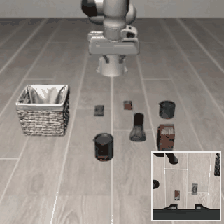
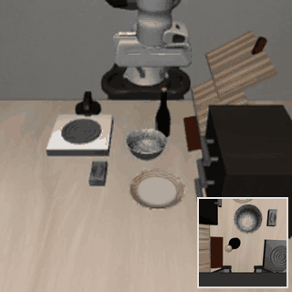
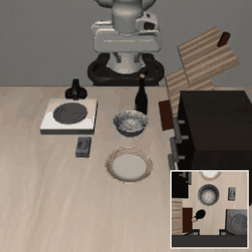
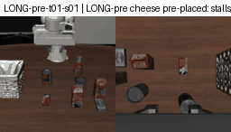
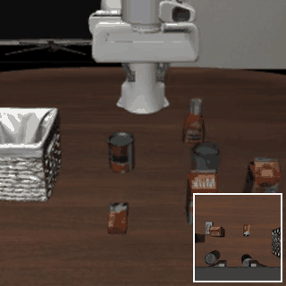

# VLA-SceneGraph — where does π0 stop looking at the scene?

Assignment 3 (Scene Graphs × Vision-Language-Action models). We reproduce the official
**π0 (`pi0_libero`, openpi)** checkpoint on LIBERO. We then probe it with controlled
spatial and temporal interventions across all four LIBERO suites, to find a
limitation an explicit scene graph could address.

**Main finding.** π0 is near-perfect on the official scenes: 49/50 on Spatial and
9/9 on the Object, Goal and Long baselines. It fails whenever the *meaning* of the
scene and its *trained layout* disagree:

- In the Object suite, it fetches whatever sits at the trained position (0/9).
- In the Goal suite, it carries objects to where the destination used to be (1/6).
- In the Long suite, it does not re-read sub-goal progress from the scene (0/9).

Matched controls that change the layout without changing the meaning stay high:
S2-ctrl 6/6, T1-ctrl 8/8, OBJ-swap-ctrl 7/9 and GOAL-move-ctrl 8/8.

## Results

### LIBERO-Spatial: reproduction and first probes

| ID | Intervention | Success | Reading |
|---|---|---:|---|
| E0 | Official scene and instruction (10 tasks × 5 initial states) | **49/50** | Reduced reproduction; official-client parity passed |
| S1 | The instruction names the *other* identical bowl by its relation | 22/27 | Language mostly followed (26/27 on the matched E0 subset) |
| S2 | A landmark is moved so the stated relation selects the other bowl | **0/6** | The bowl at the trained position is placed every time |
| S2-ctrl | The same landmark is moved; the target is unchanged | 6/6 | Layout novelty alone does not explain S2 |
| T1 | The bowls are swapped before the start; the instruction refers to the pre-swap layout | **0/8** | Expected for a policy that receives a single frame and no history |
| T1-ctrl | Same instruction and idle period, no swap | 8/8 | |

### Cross-suite follow-up: Object / Goal / Long

The protocol was declared before any rollout ([protocol](docs/protocols/CROSS_SUITE.md)).
Each condition runs 3 tasks × initial states 0–2, with policy noise paired to the
suite's E0.

| Suite | Condition | Intervention | Success |
|---|---|---|---:|
| Object | OBJ-E0 | official | 9/9 |
| | **OBJ-swap** | target ↔ the object in the *other* canonical target slot | **0/9** |
| | OBJ-swap-ctrl | two distractors swap places | 7/9 |
| | OBJ-lang | the instruction names the object in the other slot | 8/9 |
| Goal | GOAL-E0 | official | 9/9 |
| | **GOAL-move** | the task-relevant object is relocated (~12 cm) | **4/9** |
| | GOAL-move-ctrl | an irrelevant object is relocated | 8/8 |
| Long | LONG-E0 | official two-object tasks | 9/9 |
| | **LONG-pre** | the first sub-goal is already done at the start | **3/9** |
| | **LONG-undo** | the first placed object is returned to its start pose mid-episode | **0/9** |

Per-episode table: [results/cross_suite/summary.md](results/cross_suite/summary.md) ·
findings: [results/cross_suite/](results/cross_suite/README.md) ·
Spatial findings: [results/spatial/](results/spatial/README.md).

## Insights

1. **Position beats identity.** Swapping the target with the object in the other
   canonical slot fails 9/9. In 7 of those episodes the first object lifted is the
   decoy now sitting at the trained position. Swapping two unrelated objects costs
   only 2/9. Spatial S2 shows the same pattern with identical bowls; OBJ-swap
   shows it with visually distinct objects.
2. **Language selects a memorised (object, position) routine.** Naming a different
   object works (OBJ-lang 8/9, S1 22/27) when that object sits where its own
   training task puts it. Once identity and position disagree (OBJ-swap, S2), the
   position wins.
3. **pi0 is closed-loop for the object it picks up and open-loop for where it puts
   it.** When the object to pick up moved, pi0 reached it at its new position (3/3
   success). When the destination moved, it succeeded 1/6, and in 3 of the 5
   failures the carried object came within 1 cm of the destination's *old*
   position (measured from logged poses).
4. **Progress is a learned timeline, not something read from the scene.** If the
   first sub-goal is undone after it was achieved, pi0 places the second object and
   never returns to the first (0/9). This happens even though the current frame
   shows what is missing. Pre-completing the first sub-goal also breaks the
   routine (3/9; a wrong object was lifted first in 4/9).
5. **What this means for a scene graph (Part 4).** The failures share one gap: the
   policy has no explicit, current binding between *instruction entities*,
   *object identities/positions* and *task progress*. A graph that
   - resolves the instruction to a target node and destination node with live 3D
     poses, and
   - stores sub-goal predicates with an event history

   addresses exactly the variables these interventions perturb. The OBJ-lang
   result suggests that rewriting the instruction in text alone will not fix
   OBJ-swap or GOAL-move: language is followed only when it agrees with the trained
   layout. A spatial interface (target/destination masks or graph tokens) is the
   stronger candidate.

## Example episodes

The large view is the agent camera and the inset is the wrist camera, the same frames the policy sees.
Each row pairs a working case with a failure. Details are in the
[findings](results/cross_suite/README.md).

**LIBERO-Object: the named object, or whatever sits at the usual spot?**

<table><tr>
<td width="50%" valign="top"> <b>OBJ-E0</b>: <i>"pick up the alphabet soup and place it in the basket"</i> ✅ Soup placed in the basket.</td>
<td width="50%" valign="top"> <b>OBJ-swap</b>: same instruction, but the soup and the salad dressing have swapped places. ❌ Grabs the <b>dressing</b> at the soup's usual spot and never reaches the basket.</td>
</tr></table>

**LIBERO-Goal: does π0 follow an object that has moved?**

<table><tr>
<td width="50%" valign="top"> <b>GOAL-move</b>: <i>"put the bowl on the stove"</i>, with the bowl moved 12 cm. ✅ Follows the bowl to its new position.</td>
<td width="50%" valign="top"> <b>GOAL-move</b>: <i>"put the cream cheese in the bowl"</i>, with the bowl moved 12 cm. ❌ Carries the cheese to the bowl's <b>old</b> position (0 cm from it).</td>
</tr></table>

**LIBERO-Spatial S2: a landmark moves, so the instruction now means the other bowl**

<table><tr>
<td width="50%" valign="top"> <b>S2-ctrl</b>: <i>"…the black bowl next to the ramekin…"</i>. The ramekin moves but the target bowl stays the same. ✅ Correct bowl placed.</td>
<td width="50%" valign="top"> <b>S2</b>: same instruction, but the ramekin now sits next to the <b>other</b> bowl. ❌ Places the bowl at the trained position (6/6 episodes).</td>
</tr></table>

**LIBERO-Spatial T1: the instruction refers to the scene before a swap**

<table><tr>
<td width="50%" valign="top"> <b>T1-ctrl</b>: <i>"…the bowl that was between the plate and the ramekin at the start…"</i>, no swap. ✅ Correct bowl placed.</td>
<td width="50%" valign="top"> <b>T1</b>: same instruction, but the bowls are swapped before the start. ❌ Places the bowl now at the old position. Expected for a policy with no history.</td>
</tr></table>

**LIBERO-Long: is task progress read from the scene?**

<table><tr>
<td width="50%" valign="top"> <b>LONG-pre</b>: <i>"put both the cream cheese box and the butter in the basket"</i>, with the cream cheese already in the basket. ❌ Pushes boxes around and never lifts anything.</td>
<td width="50%" valign="top"> <b>LONG-undo</b>: <i>"put both the alphabet soup and the tomato sauce in the basket"</i>. The soup is taken out of the basket after it is placed. ❌ Places the sauce, then idles. It never goes back for the soup.</td>
</tr></table>

**LIBERO-Spatial S1: the instruction names the other, identical bowl**

<table><tr>
<td width="50%" valign="top"> <b>S1</b>: <i>"…the black bowl next to the cookie box…"</i> (bowl 2). ✅ Bowl 2 placed. With the scene unchanged, the policy follows language in 22/27 episodes.</td>
<td width="50%" valign="top"> <b>S1</b>: <i>"…the black bowl next to the ramekin…"</i> (bowl 2). ❌ Hovers over the bowls and places none.</td>
</tr></table>

## Caveats

Each condition is small (6–27 episodes, 2–9 tasks) and clustered by task. All
p-values in the analysis are exploratory. Interventions are scripted simulator
state edits, not robot actions. Displacements differ between treatment and control.
T1 does not test memory cleanly, because the input prefixes diverge
([Spatial findings](results/spatial/README.md)). E0 is a reduced 50-episode pilot, not a
full-suite reproduction. No graph-augmented policy has been evaluated yet.

## Experiment runtime

All experiments were run in a [molab](https://molab.marimo.io) notebook runtime
with an NVIDIA RTX PRO 6000 Blackwell GPU, using the official `pi0_libero` checkpoint.
