# VLA-SceneGraph — where does π0 stop looking at the scene?

Assignment 3 (Scene Graphs × Vision-Language-Action models). We reproduce the official
**π0 (`pi0_libero`, openpi)** checkpoint on LIBERO. We then probe it with controlled
spatial and temporal interventions across all four LIBERO suites, to find a
limitation an explicit scene graph could address.

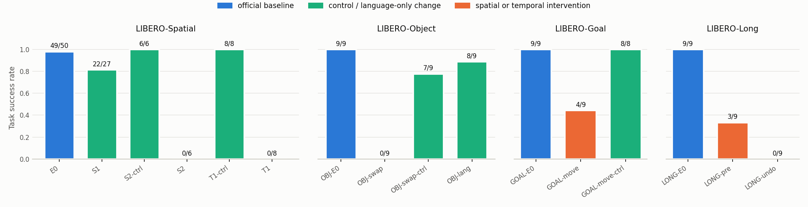

## Results

### LIBERO-Spatial: reproduction and first probes

| ID | Intervention | Success | Reading |
|---|---|---:|---|
| E0 | Official scene and instruction (10 tasks × 5 initial states) | **49/50** | Reduced reproduction; official-client parity passed |
| S1 | The instruction names the *other* identical bowl by its relation | 22/27 | Language mostly followed (26/27 on the matched E0 subset) |
| S2 | A landmark is moved so the stated relation selects the other bowl | **0/6** | The bowl at the trained position is placed every time |
| S2-ctrl | The same landmark is moved; the target is unchanged | 6/6 | Layout novelty alone does not explain S2 |
| T1 | The bowls are swapped before the start; the instruction refers to the pre-swap layout | **0/8** | Expected for a policy that receives a single frame and no history |
| T1-ctrl | Same instruction and idle period, no swap | 8/8 | |

### Cross-suite follow-up: Object / Goal / Long

| Suite | Condition | Intervention | Success |
|---|---|---|---:|
| Object | OBJ-E0 | official | 9/9 |
| | **OBJ-swap** | target ↔ the object in the *other* canonical target slot | **0/9** |
| | OBJ-swap-ctrl | two distractors swap places | 7/9 |
| | OBJ-lang | the instruction names the object in the other slot | 8/9 |
| Goal | GOAL-E0 | official | 9/9 |
| | **GOAL-move** | the task-relevant object is relocated (~12 cm) | **4/9** |
| | GOAL-move-ctrl | an irrelevant object is relocated | 8/8 |
| Long | LONG-E0 | official two-object tasks | 9/9 |
| | **LONG-pre** | the first sub-goal is already done at the start | **3/9** |
| | **LONG-undo** | the first placed object is returned to its start pose mid-episode | **0/9** |

## Example episodes

The large view is the agent camera and the inset is the wrist camera, the same frames the policy sees.
Each row pairs a working case with a failure. Details are in the
[findings](results/cross_suite/README.md).

**LIBERO-Object: the named object, or whatever sits at the usual spot?**

<table><tr>
<td width="50%" valign="top">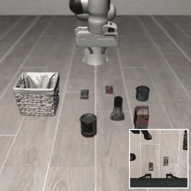 <b>OBJ-E0</b>: <i>"pick up the alphabet soup and place it in the basket"</i> ✅ Soup placed in the basket.</td>
<td width="50%" valign="top">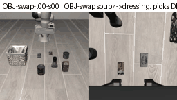 <b>OBJ-swap</b>: same instruction, but the soup and the salad dressing have swapped places. ❌ Grabs the <b>dressing</b> at the soup's usual spot and never reaches the basket.</td>
</tr></table>

**LIBERO-Goal: does π0 follow an object that has moved?**

<table><tr>
<td width="50%" valign="top">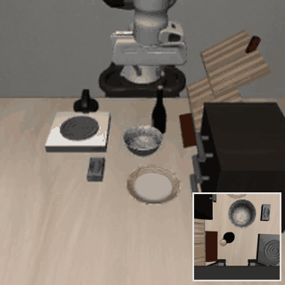 <b>GOAL-move</b>: <i>"put the bowl on the stove"</i>, with the bowl moved 12 cm. ✅ Follows the bowl to its new position.</td>
<td width="50%" valign="top">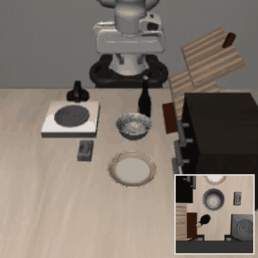 <b>GOAL-move</b>: <i>"put the cream cheese in the bowl"</i>, with the bowl moved 12 cm. ❌ Carries the cheese to the bowl's <b>old</b> position (0 cm from it).</td>
</tr></table>

**LIBERO-Spatial S2: a landmark moves, so the instruction now means the other bowl**

<table><tr>
<td width="50%" valign="top"> <b>S2-ctrl</b>: <i>"…the black bowl next to the ramekin…"</i>. The ramekin moves but the target bowl stays the same. ✅ Correct bowl placed.</td>
<td width="50%" valign="top">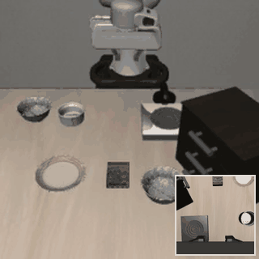 <b>S2</b>: same instruction, but the ramekin now sits next to the <b>other</b> bowl. ❌ Places the bowl at the trained position (6/6 episodes).</td>
</tr></table>

**LIBERO-Spatial T1: the instruction refers to the scene before a swap**

<table><tr>
<td width="50%" valign="top">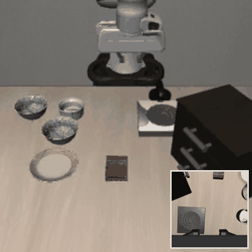 <b>T1-ctrl</b>: <i>"…the bowl that was between the plate and the ramekin at the start…"</i>, no swap. ✅ Correct bowl placed.</td>
<td width="50%" valign="top">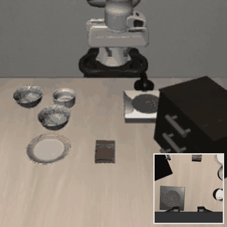 <b>T1</b>: same instruction, but the bowls are swapped before the start. ❌ Places the bowl now at the old position. Expected for a policy with no history.</td>
</tr></table>

**LIBERO-Long: is task progress read from the scene?**

<table><tr>
<td width="50%" valign="top">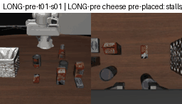 <b>LONG-pre</b>: <i>"put both the cream cheese box and the butter in the basket"</i>, with the cream cheese already in the basket. ❌ Pushes boxes around and never lifts anything.</td>
<td width="50%" valign="top">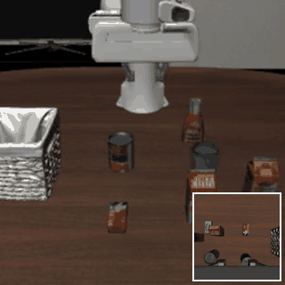 <b>LONG-undo</b>: <i>"put both the alphabet soup and the tomato sauce in the basket"</i>. The soup is taken out of the basket after it is placed. ❌ Places the sauce, then idles. It never goes back for the soup.</td>
</tr></table>

**LIBERO-Spatial S1: the instruction names the other, identical bowl**

<table><tr>
<td width="50%" valign="top">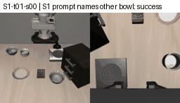 <b>S1</b>: <i>"…the black bowl next to the cookie box…"</i> (bowl 2). ✅ Bowl 2 placed. With the scene unchanged, the policy follows language in 22/27 episodes.</td>
<td width="50%" valign="top">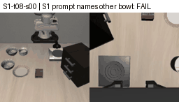 <b>S1</b>: <i>"…the black bowl next to the ramekin…"</i> (bowl 2). ❌ Hovers over the bowls and places none.</td>
</tr></table>

## Reproduce

All experiments ran in a [molab](https://molab.marimo.io) notebook on an NVIDIA RTX PRO 6000 Blackwell GPU with the official `pi0_libero` checkpoint (openpi `215abfb`, LIBERO `f78abd6`, JAX, OSMesa; pinned in [configs/part2_smoke.json](configs/part2_smoke.json)). On molab, clone this repo into `~/vla_scenegraph_work` and run `python -m sgvla` to install the server and client environments, download the checkpoint and start the policy server. Then run E0, the Spatial probes (`python -m sgvla.analysis`) and the cross-suite run (`python -m sgvla.cross_suite`); the exact commands are in [REPRODUCE.md](docs/reproduction/REPRODUCE.md), and `pytest` checks the results locally on CPU.
