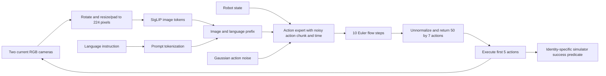

# Reproduced pi0_libero pipeline

This walkthrough describes the pinned JAX `pi0_libero` checkpoint, without training
or a graph input. Source pin: openpi `215abfb217dbac7d5f1273282331b9b1866c0479`.
Paths below refer to that checkout under `third_party/openpi/` in the parent project.

## Observation and preprocessing

`src/sgvla/baselines/openpi/rollout.py`, `observation_element`, constructs the
wire observation from `agentview_image` and `robot0_eye_in_hand_image`. Both images
are rotated 180 degrees, resized with aspect-preserving padding to 224 by 224, and
converted to uint8. The eight state entries concatenate end-effector position,
axis-angle orientation, and the two gripper joint positions. `prompt` is a string.

Object poses and full simulator states are logged for evaluation; they are not
included in this policy observation. No earlier camera frames are supplied to the
model at the next replan. The client retains a short queue of already generated
actions, which is different from maintaining an object/event memory.

The upstream `src/openpi/policies/libero_policy.py`, `LiberoInputs`, maps these
fields to the model observation. A third image slot is zero-filled and masked for
pi0. The policy factory in `src/openpi/policies/policy_config.py` loads checkpoint
normalization assets and composes input/output transforms. Prompt tokenization and
padding are configured through `src/openpi/training/config.py`.

## Model components and attention

In `src/openpi/models/pi0.py`, model construction starts around line 68;
`embed_prefix` starts at line 106 and `embed_suffix` at line 140. The image encoder
is SigLIP, and the language/image transformer and action expert use the configured
Gemma variants. Images and instruction tokens form the prefix. The pi0 suffix
includes robot-state conditioning and noisy action/time tokens. Block attention
masks let action tokens attend to the conditioning prefix while preventing prefix
tokens from depending on the proposed actions. The action chunk is generated jointly,
rather than as an autoregressive sequence of discrete action tokens.

The model's internal action dimension is padded (`Pi0Config.action_dim` defaults to
32); the LIBERO output transform selects seven physical action dimensions. The
internal 50-step horizon and the externally returned `(50, 7)` array should not be
confused with executing 50 actions before observing again.

## Training objective being reproduced

The released checkpoint was trained upstream. No optimization is performed in our
experiments. The objective is nevertheless part of the architecture explanation.
For a normalized demonstration chunk A and Gaussian noise epsilon, the pinned
implementation uses

\[
A^\tau=\tau\epsilon+(1-\tau)A,\qquad
u=\epsilon-A,\qquad
\mathcal L=\mathbb E\|v_\theta(A^\tau,\tau,o)-u\|^2.
\]

`compute_loss`, lines 189–214, samples
`tau = Beta(1.5, 1) * 0.999 + 0.001` and computes squared velocity error.
This source convention has noise at tau=1 and data at tau=0; retain its sign and
time direction consistently when comparing with diffusion and the paper notation.

## Action generation and execution

`sample_actions`, lines 217–278, initializes a Gaussian chunk, caches the prefix
keys/values, then applies explicit Euler updates

\[
A_{k+1}=A_k+\Delta\tau\,v_\theta(A_k,\tau_k,o),
\qquad \Delta\tau=-1/10.
\]

The output transforms unnormalize actions. `LiberoOutputs` selects seven entries
per action. In `src/sgvla/eval/run_libero.py`, `run_control_loop`, the client checks
for `(50, 7)`, executes the first five actions, then requests another chunk using
the new camera images and robot state. Per-episode explicit sampling noise is
controlled by `src/sgvla/baselines/openpi/seeded.py` for paired comparisons.

## Metric, traces and validation

E0 uses the official task's success result, with a 220-action Spatial limit and ten
settling steps. Part 3 uses the official identity-specific `On(target, plate)`
predicate through `TargetEnv` in `src/sgvla/analysis/rollout.py`; this preserves the
placement/contact semantics while changing the selected instance when required.

Success rate is successful completed episodes divided by valid completed episodes.
A completed timeout is a task failure; an infrastructure/protocol error remains a
retryable attempt and does not enter that denominator. First placed identity is a
separate diagnostic, not a replacement for eventual target success.

`src/sgvla/eval/trace.py` stores both videos, actions, robot state, all object poses,
full simulator states, action chunks, policy-call frames, input hashes and latency.
Completion acceptance checks hashes, numerical arrays and full video decoding.
Latency values must be taken from run artifacts; no real-time performance claim is
made from action chunking alone.

Official-client parity instruments the unmodified official loop on task 0, initial
states 0–2, and compares byte-identical processed observations, steps, outcomes,
chunks and actions (absolute action tolerance 1e-5, relative tolerance zero).
See `src/sgvla/eval/parity.py` and the retained parity report for each runtime.
